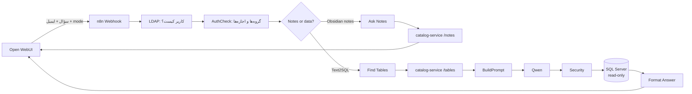

# Text2SQL

کاربر در **Open WebUI** به فارسی سؤال می‌پرسد و دو نوع جواب می‌گیرد:

| مدل در Open WebUI | برای چه سؤالی | جواب |
|---|---|---|
| **Text2SQL** | عدد و داده: «فروش خالص ماه گذشته به تفکیک محصول» | یک کوئری فقط‌خواندنی T-SQL روی `SA_DataWarehouse`، جدول و نمودار نتیجه، و نام یادداشت‌های Obsidian که جواب از آن‌ها آمد |
| **Obsidian notes** | توضیح و راهنما: «فروش خالص چطور حساب می‌شود؟»، «جدول مشتری با کدام جدول‌ها join می‌شود؟» | جواب Qwen فقط از روی یادداشت‌های Obsidian، با فهرست یادداشت‌هایی که استفاده شد |

مدل زبانی **Qwen 32B** است که روی یک سرور جدا اجرا می‌شود (آدرس `/combine`).
**هر چیزی که مدل دربارهٔ جدول‌ها می‌داند در Obsidian نوشته می‌شود.** n8n نه کاتالوگی می‌خواند و نه جست‌وجویی انجام
می‌دهد؛ برای هر سؤال فقط یک بار از سرویس `catalog-service` می‌پرسد.

---

## ۱. یک سؤال چه مسیری را طی می‌کند؟



**سؤال داده (Text2SQL):**
1. **Webhook** سؤال، ایمیل کاربر و `mode` را از Open WebUI می‌گیرد.
2. **LDAP** کاربر را در Active Directory پیدا می‌کند و **AuthCheck** گروه‌هایش را مشخص می‌کند (مثلاً `NLSQL-sales`).
3. **Find Tables** سؤال و گروه‌ها را به `catalog-service` می‌فرستد. سرویس فقط از میان جدول‌هایی که این کاربر اجازه دارد،
   جدول‌های مناسب، joinهای بینشان، مثال‌های مشابه، مقدارها و معیارها را انتخاب می‌کند.
4. **BuildPrompt** از این طرح متن prompt را می‌نویسد. **Qwen** جواب را به شکل UNDERSTOOD / PLAN / SQL برمی‌گرداند.
5. **Security** فقط `SELECT` فقط‌خواندنی را قبول می‌کند، `TOP 200` می‌گذارد و هر جدول را به نسخهٔ مجاز همان کاربر
   (فقط ستون‌های مجاز) تبدیل می‌کند.
6. **execute query** کوئری را با login فقط‌خواندنی اجرا می‌کند. اگر خطا داد، یک بار خطا به Qwen برمی‌گردد تا اصلاح کند.
7. **Format Answer** جدول Markdown و نمودار را می‌سازد و آخر جواب می‌نویسد از کدام یادداشت‌ها آمده:
   `📎 یادداشت‌های Obsidian: Fact_Sales · Dim_Product · معیار «فروش خالص»`.

**سؤال یادداشت (Obsidian notes):** بعد از مرحلهٔ ۲، **Ask Notes** سؤال را به `catalog-service` می‌فرستد. سرویس نزدیک‌ترین
تکه‌های یادداشت‌هایی را که کاربر اجازه دارد پیدا می‌کند، به Qwen می‌دهد و جواب را همراه نام یادداشت‌ها برمی‌گرداند.

workflow اصلی **۱۹ نود** دارد. پیش از این شاخه ۲۱ نود بود و دستیار Obsidian هم یک workflow جدا با ۱۲ نود داشت.

---

## ۲. Obsidian کجای کار است؟

پوشهٔ `obsidian/` یک vault است: آن را در Obsidian باز کنید. **کاتالوگ همین یادداشت‌هاست.**

| یادداشت | چه چیزی در آن نوشته می‌شود |
|---|---|
| `Catalog/<حوزه>/<حوزه>.md` (مثلاً `sales.md`) | چه گروه AD چه جدول‌هایی را ببیند، قواعد حوزه، معیارها («فروش خالص» = فرمول دقیق)، مثال‌های سؤال + SQL |
| `Catalog/<حوزه>/<جدول>.md` (مثلاً `Fact_Sales.md`) | توضیح جدول، مترادف‌ها، ستون‌ها (Show = `yes` / `hidden` / `review`)، **روابط با جدول‌های دیگر** |
| `Catalog/Rules for every question.md` | قواعدی که برای همهٔ سؤال‌ها به مدل گفته می‌شود |
| `Home.md`، `How-to.md`، `Architecture.md`، `Me.md` | وضعیت پروژه، دستور هر کار، طراحی و دلیل تصمیم‌ها، صاحب پروژه |
| `Schema.md` | همهٔ جدول‌ها و روابطشان در یک صفحه (خودکار ساخته می‌شود، ویرایش نکنید) |
| `Inbox/` | یادداشت‌هایی که n8n می‌نویسد (سؤال‌های بی‌جواب، جواب‌ها برای تیک ✅/❌) - در git نیست |

**روابط (joins):** در هر یادداشت جدول، بخش *Links to other tables* یک خط برای هر رابطه دارد. این‌ها به بخش `joins`
همان کاتالوگ تبدیل می‌شوند:

```json
"joins": [
  { "from": "Fact_Purchase", "from_column": "FiscalYear_Key",
    "to": "Sales_Dim_FiscalYear", "to_column": "FiscalYear_Key", "type": "INNER", "inferred": true }
]
```

از این روابط در سه جا استفاده می‌شود:
1. **انتخاب جدول‌ها:** اگر دو جدول لازم مستقیم به هم وصل نباشند، کوتاه‌ترین مسیر روی همین گراف پیدا می‌شود و جدول واسط هم به prompt اضافه می‌شود.
2. **prompt:** هر رابطه بین جدول‌های انتخاب‌شده به شکل `[Fact_Purchase].[FiscalYear_Key] = [Sales_Dim_FiscalYear].[FiscalYear_Key]` به Qwen داده می‌شود.
3. **جست‌وجوی یادداشت‌ها و `Schema.md`:** هر جدول همراه روابطش در هر دو جهت نشان داده می‌شود.

`"inferred": true` یعنی رابطه از هم‌نام بودن ستون‌ها حدس زده شده و کلید خارجی تعریف‌شده در دیتابیس نیست.

**از یادداشت تا مدل، خودکار:** سرویس `indexer-watch` هر دقیقه:
1. یادداشت‌ها را به `catalog/*.json` تبدیل می‌کند. اگر یادداشتی اشتباه داشته باشد هیچ فایلی عوض نمی‌شود و خطا در `Inbox/System check.md` نوشته می‌شود.
2. `Schema.md` را به‌روز می‌کند.
3. embeddingها را فقط برای چیزهایی که عوض شده می‌سازد.

`catalog-service` فایل‌های تازه را خودش برمی‌دارد. پس تغییری که در Obsidian ذخیره می‌کنید حداکثر یک دقیقه بعد به مدل
می‌رسد، بدون هیچ کاری در n8n.

---

## ۳. جدول‌ها چطور انتخاب می‌شوند؟

هیچ وزن یا آستانه‌ای دستی انتخاب نشده است. سیستم از سؤال‌های برچسب‌دار benchmark **یاد می‌گیرد** که هر نوع شاهد
چقدر ارزش دارد. این سؤال‌ها ۶۹ سؤال با جدول‌های لازمشان و ۳ سؤال «غیرقابل‌پاسخ» هستند، و با هر تیک ✅ بیشتر می‌شوند.

**گام ۱. شواهد هر جدول** (`catalog-service/text2sql/`)

| شاهد | چطور اندازه‌گیری می‌شود |
|---|---|
| **کلمه‌ها** (`lexical.js`) | مثل موتورهای جست‌وجو (BM25F)؛ جزئیات زیر جدول |
| **معنا** (`bge-m3`) | فاصلهٔ شباهت سؤال با کارت جدول و با ۳ ستون نزدیکش از میانگین همهٔ جدول‌ها (z-score) |
| **reranker** (اختیاری) | یک مدل cross-encoder سؤال و کارت هر کدام از ۲۰ جدول محتمل‌تر را **با هم** می‌خواند و می‌سنجد |

جزئیات شاهد کلمه‌ای:
- **فقط کلمهٔ کامل:** «سن» دیگر داخل «حسنی» پیدا نمی‌شود.
- **اول بلندترین عبارت:** «دفتر» داخل «دفتر فروش» دوباره شمرده نمی‌شود.
- **کمیابی (IDF):** عبارتی که در جدول‌های زیادی هست کمتر می‌ارزد.
- **طول فیلد:** در جدول پهن، هر ستونِ پیدا‌شده کمتر می‌ارزد.

**گام ۲. احتمال** (`relevance.js`)
- یک مدل logistic regression از این شواهد، احتمال لازم بودن هر جدول را حساب می‌کند.
- وزن‌ها و همهٔ آستانه‌ها را `scripts/train-retrieval.js` می‌سازد: روی سرور در `catalog/retrieval-model.json` (در git نیست)، و یک مدل پایهٔ فقط کلمه‌ای همراه کد در `catalog-service/text2sql/baseline-model.json`. آستانه‌ها این‌ها هستند: کِی جدول فرستاده شود، کدام حوزه‌ها و حداکثر چند حوزه، مسیر join، و «احتمالاً قابل پاسخ نیست».
- برای هر ترکیب از سرویس‌ها مدل جدا یاد گرفته می‌شود: فقط کلمه، کلمه + معنا، و با reranker. اگر سرویسی در دسترس نباشد، مدلی به کار می‌رود که برای همان وضعیت یاد گرفته شده است.

**گام ۳. قاعده‌ها** (همیشه فرستاده می‌شوند، چون یک انسان صریحاً در کاتالوگ نوشته است):
- جدول‌های فرمول معیاری که نامش در سؤال آمده
- جدولی که یک مقدار ذخیره‌شده‌اش کامل در سؤال آمده
- الگوی جدول؛ مثلاً سال شمسی ← `Dim_Date`

**گام ۴. ساختار:** جدول اصلی هر حوزهٔ فعال، بُعدهایی که مستقیم join می‌شوند، و جدول واسط روی گراف `joins` اضافه می‌شوند. روابط هیچ‌وقت از embedding حدس زده نمی‌شوند.

**یادگیری آستانه‌ها:** آستانه‌ها روی خود pipeline واقعی (با بودجهٔ ۲۴ هزار کاراکتری) با معیار **F4** انتخاب می‌شوند؛ یعنی جاافتادن یک جدول ۱۶ برابرِ یک جدول اضافه هزینه دارد.

**یادگیری خودکار:** `indexer-watch` هر وقت کاتالوگ، سؤال‌ها یا سرویس‌ها عوض شوند، مدل را روی سرور با embedding واقعی دوباره یاد می‌گیرد. تا آن موقع مدل پایه به کار می‌رود، که فقط کلمه‌ای است چون `bge-m3` جایی که ساخته شد قابل دانلود نبود.

**نتیجه، اندازه‌گیری‌شده:** هر سؤال را مدلی جواب داده که آن را ندیده بود (10-fold cross-validation)، و فقط با شواهد کلمه‌ای.

| مجموعه | امتیازهای دستی قبلی | مدل یادگرفته |
|---|---|---|
| سؤال‌های اصلی | ۳۵ از ۳۵ (۱۵.۹ جدول در prompt) | ۳۳ از ۳۵ (۱۱.۴ جدول) |
| سؤال‌های نیازمند جدول واسط | ۱۲ از ۱۴ | ۱۳ از ۱۴ |
| بازنویسی‌ها (همان سؤال با کلمات دیگر) | ۷ از ۲۰ | ۹ از ۲۰ |

بهبود اصلی از معنا و reranker انتظار می‌رود و باید روی سرور اندازه‌گیری شود (`obsidian/How-to.md`، بخش *Table-choice model*).

**دسترسی** در همه‌جا یکی است: همان `permissions` کاتالوگ. کاربری که فقط `NLSQL-hr` است نه SQL روی جدول‌های فروش
می‌گیرد و نه توضیحی دربارهٔ آن‌ها.

**جست‌وجوی یادداشت‌ها** (مدل «Obsidian notes»):
- هر جدول **یک تکهٔ کامل** است، با ستون‌ها و روابطش.
- بقیهٔ یادداشت‌ها بر اساس سرتیتر `##` تکه می‌شوند.
- برای هر سؤال حداکثر ۸ تکهٔ نزدیک انتخاب می‌شود.

---

## ۴. اجزا

| جزء | کجا | کار |
|---|---|---|
| n8n | `n8n_workflows/final_improving security.json` | workflow اصلی (webhook `/webhook/text2sql`). کد هر Code node در `n8n_workflows/code/<نام نود>.js` است |
| catalog-service | `catalog-service/` | جست‌وجو برای n8n: `POST /tables` و `POST /notes`. پورتش بیرون باز نیست |
| Open WebUI function | `openwebui/text2sql.py` | دو مدل Text2SQL و Obsidian notes، هر دو به همان webhook |
| indexer-watch | `docker-compose.yml` | هر دقیقه: یادداشت‌ها ← کاتالوگ، `Schema.md`، embeddingها، یادگیری مدل انتخاب جدول، System check |
| reranker (اختیاری) | `docker-compose.yml`، profile `reranker` | مدل `BAAI/bge-reranker-v2-m3` برای سنجش دوبارهٔ ۲۰ جدول محتمل‌تر |
| embeddings (bge-m3) | Ollama روی همین سرور (`ollama pull bge-m3`) | بردار معنای سؤال، جدول‌ها و یادداشت‌ها. آدرس: `EMBED_URL` (پیش‌فرض `http://host.docker.internal:11434/api/embed?model=bge-m3`). اگر Hugging Face در دسترس است، می‌شود به‌جایش سرویس TEI (profile `tei`) را به کار برد |
| Qwen 32B | سرور جدا، `http://172.16.55.28:5000/combine` | نوشتن SQL و جواب یادداشت‌ها |
| SQL Server | `SA_DataWarehouse` | داده؛ login مخصوص n8n فقط‌خواندنی است |

ساختار `catalog-service` (هر فایل یک کار):

| فایل | کار |
|---|---|
| `server.js` | فقط HTTP: مسیرها، بررسی شکل درخواست، JSON |
| `use-cases.js` | `tables()` و `notes()`؛ اجزای زیر را کنار هم می‌گذارد |
| `knowledge.js` | خواندن `catalog/*.json` و `vault-index/` و نگه داشتنشان تا وقتی فایل عوض شود |
| `clients.js` | سرویس embeddings (اگر خطا بدهد فقط جست‌وجوی کلمه‌ای)، reranker و Qwen |
| `text2sql/find-tables.js` | مراحل انتخاب: دسترسی، شواهد، احتمال، قاعده‌ها، حوزه‌ها، جدول‌ها، مثال‌ها |
| `text2sql/lexical.js` | شاهد کلمه‌ای (BM25F) |
| `text2sql/relevance.js` | ویژگی‌ها و مدل یادگرفته‌شده (احتمال هر جدول) |
| `notes/*.js` | جست‌وجوی یادداشت‌ها ← prompt ← جواب با منبع |
| `config.js` | تنظیمات (`EMBED_URL`، `LLM_URL`، ...) |

---

## ۵. راه‌اندازی، مرحله به مرحله

همهٔ دستورها در پوشهٔ پروژه (همان‌جا که `docker-compose.yml` هست) اجرا می‌شوند.

1. **گرفتن کد:**
   ```
   git fetch origin obsidian_04
   git checkout obsidian_04
   ```
   **پیش‌نیاز embedding:** مدل `bge-m3` باید در Ollama باشد (`ollama list` آن را نشان دهد؛ اگر نیست: `ollama pull bge-m3`).
   containerها Ollama را در `http://host.docker.internal:11434` پیدا می‌کنند. اگر Ollama روی سرور دیگری است، کنار
   `docker-compose.yml` یک فایل `.env` بسازید با یک خط: `EMBED_URL=http://<آدرس سرور>:11434/api/embed?model=bge-m3`.
2. **بررسی کاتالوگ:**
   ```
   docker compose run --rm indexer node scripts/validate-catalogs.js --schema sql/SA_DataWarehouse_schema.sql
   ```
   باید `0 errors` نشان دهد.
3. **راه‌اندازی همهٔ سرویس‌ها:**
   ```
   docker compose up -d
   ```
   بعد این دو لاگ را ببینید:
   - `docker compose logs catalog-service` باید `catalog-service listening on :8090` نشان دهد.
   - `docker compose logs indexer-watch` باید `vault.embeddings.json: wrote ... pieces` و
     `retrieval-model.json: wrote 2 model(s) - lexical, lexical+semantic` نشان دهد (مدل با embedding واقعی یاد گرفته شد).
   - **فقط یک بار، اگر قبلاً embeddingها را با سرویس دیگری (TEI) ساخته‌اید:** بردارها را با Ollama از نو بسازید تا همه
     از یک منبع باشند (بعدش مدل انتخاب جدول خودش دوباره یاد می‌گیرد):
     ```
     docker compose run --rm indexer node scripts/index-catalog-embeddings.js --force
     docker compose run --rm indexer node scripts/index-vault-embeddings.js --force
     ```
4. **n8n** (`http://localhost:5678`):
   1. workflow قدیمی را غیرفعال کنید. اگر قبلاً workflow جداگانهٔ `Obsidian assistant` را import کرده‌اید، آن را حذف کنید.
   2. `n8n_workflows/final_improving security.json` را import کنید.
   3. credentialهای نودهای `LDAP`، `execute query` و `Write Audit Log` را بررسی کنید.
   4. workflow را **Active** کنید.
5. **Open WebUI** (`http://localhost:3000`):
   1. بروید به **Admin Panel → Functions** و روی **+** بزنید.
   2. محتوای `openwebui/text2sql.py` را paste کنید، **Save** کنید و فعالش کنید.
   3. function قدیمی Text2SQL را (اگر داشتید) غیرفعال کنید.
   4. دو مدل **Text2SQL** و **Obsidian notes** را در فهرست مدل‌ها می‌بینید.
6. **امتحان** با یک کاربر عضو `IT - Data`:
   - مدل Text2SQL: «فروش خالص به تفکیک دفتر فروش».
   - مدل Obsidian notes: «benchmark را چطور اجرا کنم؟».

7. **(پیشنهادی) اندازه‌گیری مدل با embedding واقعی:**
   ```
   docker compose run --rm indexer node scripts/train-retrieval.js --report
   ```
   سطرهای «cross-validated» را در جدول Results در `obsidian/Home.md` بنویسید.

جزئیات بیشتر (reranker، benchmark، داده‌های دقت، تنظیمات LLM) در `obsidian/How-to.md` است.

---

## ۶. کار روزانه

- **مدل جدول اشتباه انتخاب کرد:** کلمهٔ کاربر را به `synonyms` یادداشت جدول درست اضافه کنید.
- **رابطهٔ دو جدول کم است:** در یادداشت جدول، زیر *Links to other tables* یک خط اضافه کنید:
  `` - `Product_Key` → [[Dim_Product]] `Product_key` ``
- **یک عدد کسب‌وکاری غلط حساب شد:** در یادداشت حوزه، زیر *Metrics* فرمولش را بنویسید.
- **هر هفته:** روی یادداشت‌های `Inbox/n8n/` تیک ✅ یا ❌ بزنید و `node scripts/learn-from-inbox.js` را اجرا کنید.
  هر ✅ یک سؤال آموزشی تازه برای مدل انتخاب جدول هم هست؛ مدل خودش دوباره یاد می‌گیرد.
- **وضعیت سیستم:** `Inbox/System check.md` را بخوانید. سیستم خودش را آزمایش می‌کند و هر مشکل را با نام یادداشتش می‌نویسد.

---

## ۷. نقشهٔ پوشه‌ها

| پوشه | محتوا |
|---|---|
| `obsidian/` | vault: کاتالوگ (`Catalog/`) و یادداشت‌های پروژه |
| `catalog/` | `*.json` ساخته‌شده از یادداشت‌ها (دستی ویرایش نکنید) + `query_bank.json` (مثال‌های تأییدشده) |
| `catalog-service/` | سرویس جست‌وجو |
| `n8n_workflows/` | workflow اصلی و runner بنچمارک (`Text-to-SQL Benchmark-02.json`)، کد Code nodeها در `code/` و `code-benchmark/` |
| `openwebui/` | function مربوط به Open WebUI |
| `scripts/` | تبدیل یادداشت‌ها، ساخت embeddingها، بررسی کاتالوگ، بنچمارک، System check |
| `sql/` | schema انبار داده، کوئری‌های بررسی دسترسی و بانک کوئری، جدول audit |
| `benchmark/02/` | سؤال‌های بنچمارک با SQL درست |
| `tests/` | `npm test` |
| `vault-index/` | ایندکس جست‌وجوی یادداشت‌ها (ساخته می‌شود، در git نیست) |

---

## ۸. پیش از هر commit

```
node scripts/validate-catalogs.js --schema sql/SA_DataWarehouse_schema.sql
node scripts/obsidian-to-catalog.js --check
node scripts/build-schema-note.js --check
node scripts/sync-workflow-code.js --check
node scripts/generate-verify-sql.js
node scripts/generate-value-sql.js
node scripts/generate-bank-check-sql.js
npm test
node scripts/benchmark-retrieval.js
```

اگر کد یک Code node را در `n8n_workflows/code/` عوض کردید، `node scripts/sync-workflow-code.js` آن را به workflow
منتقل می‌کند. اگر کد `catalog-service/` را عوض کردید، بعد از تست‌ها `docker compose restart catalog-service` لازم است.

---

## ۹. شاخه‌ها

هر شاخه (`rhk_branch_01` ... `rhk_branch_05`، `obsidian_01` ... `obsidian_03`) یک نسخهٔ ثابت از کل پروژه است و هیچ‌وقت
بازنویسی نمی‌شود. هر تغییر تازه از آخرین شاخه شروع می‌شود و روی یک شاخهٔ جدید می‌آید. برای اجرا همیشه آخرین شاخه را
بردارید: الان **`obsidian_03`**. اینکه هر شاخه چه چیزی اضافه کرده در [`CHANGELOG.md`](CHANGELOG.md) آمده است.
