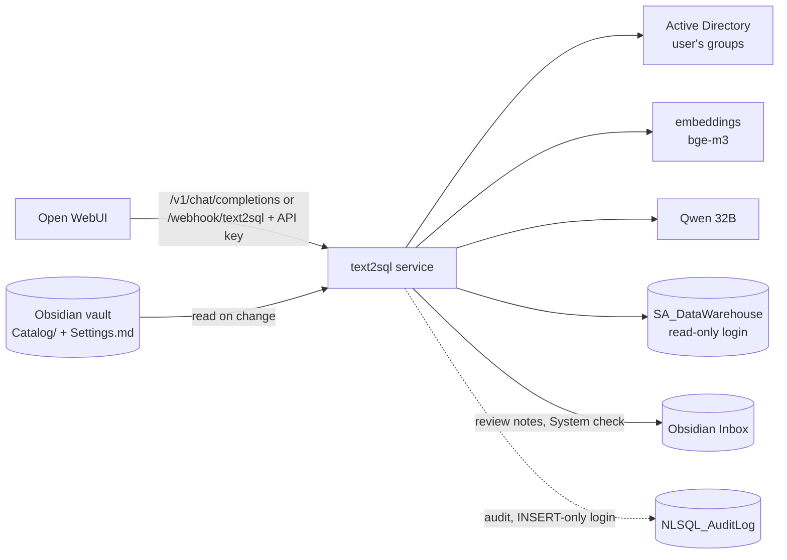

# Architecture

One question, inside the service (`text2sql/service.py`):
1. **Who** - the user's AD groups (`directory.py`); rights from [[Settings]] (details, review notes, benchmark).
2. **Find tables** (`retrieval/`) - access per domain note, keyword + meaning scores, metrics, stored values,
   domains, link tables, similar examples. Output: a *plan* with a plain reason per table.
3. **Prompt** (`prompt.py`) - rules, today in both calendars, metrics, values, examples, the tables that fit 24 000
   characters. The model answers UNDERSTOOD -> PLAN -> SQL.
4. **Model** (`llm.py`) - the current `/combine` server or any OpenAI-compatible one ([[Settings]]).
5. **SQL guard** (`guard.py`) - only SELECT, only the prompt's tables (every reference, also `[db].[schema].[x]`),
   TOP 200, each table wrapped in a CTE that exposes only its shown columns.
6. **Database** (`db.py`) - read-only login, lock and statement timeouts; on an error one repair try with SQL
   Server's message.
7. **Answer** (`answer.py`) - Markdown table + chart; review note for reviewers (`review_notes.py`), audit row.

Around it: the vault is re-read when a note changes and a note with a mistake never reaches the model
(`vault/`); `checks.py` writes the System check note; `values_store.py` reads distinct values from the database;
`learn.py` turns ✅ into examples; `benchmark.py` measures; `cli.py` is the command line.

## SOLID, concretely
- **One job per module**: the vault reader knows Markdown, the finder knows scoring, the guard knows SQL, the API
  knows HTTP. The prompt builder never sees the catalog, only the plan.
- **Data, not code, for what changes**: the catalog and settings are notes; the guard's policy and the retrieval
  numbers are data classes (`GuardPolicy`, `RetrievalSettings`); a new kind of chart or table is a new entry in a
  builder map.
- **Interfaces in, implementations chosen once** (`app.py`): the service receives a model, a database, a directory, a
  vector index. Tests swap them for fakes; `api: openai` swaps the model without touching anything else.
- **Never a silent change of behaviour**: the n8n workflow's behaviour is recorded as golden cases
  (`tests/py/fixtures`, made from the real JavaScript): search + prompt 600 cases, guard 1 006, answers and notes
  370. The Python gives the same bytes.

## Note format
`text2sql/vault/catalog_notes.py` (top of the file) defines it: domain note (Who may see it, Rules for the model,
Metrics, Examples, Tables), table note (properties source / core / synonyms / patterns; Columns with Show; Links to
other tables), `Rules for every question`, `Query bank`. Browse it in `Catalog/`.

## Why it works this way
- **Python service reading Obsidian directly** (rhk_branch_05): the vault had become the place where the catalog is
  edited, so it should be what the model knows - without a JSON copy in between. n8n could only read it through
  that copy, and its code nodes cannot share code or be tested as a whole. The service re-reads a changed note on
  the next question, validates it, and keeps the last good catalog when a note has a mistake. Embeddings are computed
  from the notes and cached by text hash (only what changed is re-embedded); the value index is read from the
  database with the read-only login, so no more SSMS export. Behaviour was carried over unchanged and proved with
  golden cases from the old JavaScript (2 000+).
- **Two ways in, one API key** (rhk_branch_05): Open WebUI can add the service as an OpenAI-compatible model (the
  user's e-mail comes from Open WebUI's forwarded header) or keep calling the old webhook URL. Either way the caller
  needs the key - before, anyone reaching the webhook could ask as any e-mail.
- **Guard holes found by the port** (4d24559): matching the JavaScript byte for byte meant reading every rule; three
  inputs read tables outside the prompt (an alias ending in WHERE hiding a comma join, no space after JOIN, a
  parenthesised table source). Fixed in both versions, with tests.
- **Shared dimensions in `common.json`** (rhk_branch_04): the 7 dimensions used by several domains live once
  instead of in every catalog, so a fix is made in one place and the prompt has no duplicates.
  A shared table alone never activates a domain.
- **Domain routing** (rhk_branch_04): 6 catalogs / 152 tables do not fit one prompt, and unrelated tables confuse
  the model. So at most 3 domains (each ≥ 60% of the best) and a character budget (17 000, now 24 000 for Qwen 32B). It was 2 domains, but
  mixed questions lost the sales domain. A missing table is usually a missing synonym - fix the catalog, not the code.
- **Qualified names go through the CTEs** (rhk_branch_05): `[dbo].[Fact_Sales]` used to bypass the CTE, so an
  HR-only user could read sales, and 19 entity names equal older physical tables. Now every reference becomes the
  entity CTE or is rejected; a model CTE named like an entity is rejected too.
- **Join paths on the catalog graph** (rhk_branch_05): the closure only follows `from -> to` one step, so a
  link table (e.g. `Procurement_Fact_Inventory` between invoice state and delivery state) reached the prompt only
  if it matched a word. Now the shortest valid path between matched tables adds it (≤ 2 per path, ≤ 3 per
  question, only readable tables). Never through a dimension both sides only reference (`A -> D <- B`, fan trap).
  The graph comes from `joins` in the catalog - the same data Obsidian draws - not from the Obsidian notes.
- **Examples by similarity, only when their tables are in the prompt** (rhk_branch_05, step 3): fixed examples ignored the
  question (DAIL-SQL). An example whose tables the user cannot read would leak another domain's schema; one whose tables
  are not in the prompt makes the model reference tables Security rejects. Benchmark questions are never copied into
  the bank (a test checks it), so the benchmark still measures generalisation.
- **Values are looked up, not guessed** (step 2): a value written differently from the database returns an empty result
  with no error. Value matches raise table scores but not the confidence: «هوای تهران» must still look unanswerable.
  `values.json` is real data, so it is built on the server and never committed.
- **Metrics are definitions, not hints** (step 5): «فروش خالص» has one correct formula with a mandatory filter; the model
  gets it word for word. A metric counts like a synonym of its tables (a floor, not an extra bonus) - adding it on top
  of the synonym it repeats pushed sales out of a mixed sales + purchase question.
- **Dim_Date is shared** (step 5): every domain asks for Persian years and months; HR/BOM/inventory users get only this
  table from `common.json` (entity-level permission). Its join is a date expression, so it is a scoped hint, not a `joins` entry.
- **Two nodes: Find Tables + BuildPrompt** (rhk_branch_05): one 1 000-line node did both the search and the prompt
  text. Split so each has one job, the prompt wording can be changed without touching the search, and n8n's
  Executions show the plan (chosen tables) separately from the prompt. Only the small plan passes between them, never
  embedding vectors. Verified: identical prompts before and after on 160 question/vector combinations.
- **PLAN before SQL** (step 6, DIN-SQL / CHASE-SQL): three short lines; Security accepts only a line-start `SQL:` label
  so plan text with "with"/"select" in it is never executed.
- **Meaning score relative to the question** (rhk_branch_05): the raw similarity of every embedding model has a
  baseline (bge-m3 gives ~0.4 even to unrelated text), so "similarity × 4" gave every table ~1.6 points: past the
  selection threshold, and the "probably not answerable" warning almost never fired; the numbers had to be re-tuned for
  each model. Now a table gets meaning points only when it stands out: more than 2 standard deviations above the mean
  similarity of all catalog tables to this question (all tables, not only the user's: with 4 numbers nothing can stand out;
  the others' vectors only enter the mean). Ordering by meaning is unchanged; nothing needs tuning.
- **Reasons, not numbers** (rhk_branch_05): each chosen table carries plain reasons (`retrieval.why`, `WHY` log, the
  Obsidian note) - «مترادف «فروش»», «معنای نزدیک به سوال», a metric, a value, a link table. Scores only order tables.
- **Review by ticking, not by writing SQL** (rhk_branch_05): writing gold SQL was the bottleneck for measuring accuracy.
  A reviewer ticks ✅/❌ on an answered-question note; ✅ stores the model's SQL as a verified bank example and the exact
  query that ran as a *confirmed* benchmark question (a regression check, kept out of the accuracy %, since it was
  chosen because the model already got it right). The answer was checked by a person who knows the data; that is the gold.
- **The system checks itself** (rhk_branch_05): `indexer-watch` runs the offline retrieval benchmark after each change
  (with embeddings when the service answers) and writes the result in words to `Inbox/System check.md`. Its floor is
  also a test: a refactor once silently dropped one question (36 -> 35); `npm test` now fails on any drop.
- **Obsidian is the catalog, JSON is generated** (rhk_branch_05): editing in Obsidian should change what the model
  knows. n8n does not parse the notes itself: a typo would then break every question, Markdown parsing would run on
  every question, and the embeddings would not follow. Instead a script in `indexer-watch` converts and validates
  them once a minute and writes only a valid catalog; the System check note names the note with a mistake. The format
  is lossless (notes -> JSON -> notes gives the same bytes, tested on all 7 catalogs). One-time change at the switch:
  joins are stored grouped by table (they now live in the table notes); the same tables and prompt lines in 310 of
  312 cases, the other two swap an equally scored dimension at the 24 000-character limit. Not in notes on purpose:
  the answer format and the security rules (the Security node parses that format; a note edit must never open the DB).
- **SOLID in n8n Code nodes** (rhk_branch_05): one job per node, one adapter that reads n8n, rights decided once in
  AuthCheck (they were copied in three nodes; a fourth copy would have drifted). Verified: old and new code give
  identical output on 3 546 input combinations. Find Tables stays one node with 8 step functions: splitting it into
  n8n nodes would pass the catalogs and embedding vectors between nodes, and n8n stores every node's output for every
  question.
- **What is embedded** (rhk_branch_05): one card per table + one vector per *distinctive* column (keys and
  descriptions repeated in 3+ tables get none); a table's column score is the mean of its top 3 columns.
  Fewer, cleaner vectors: 1 470 -> 571, sidecars 13 MB -> 4.8 MB.
