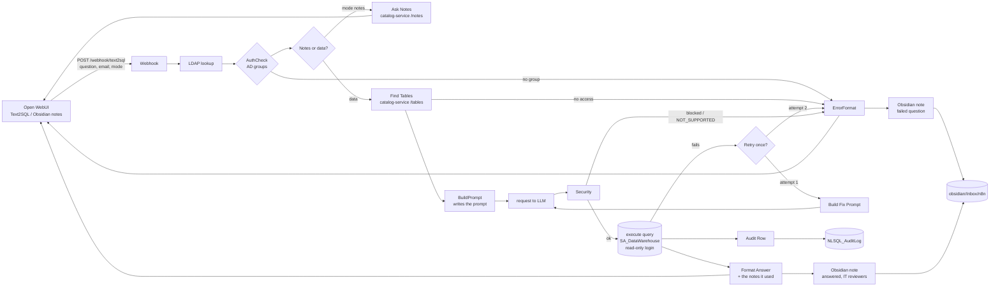
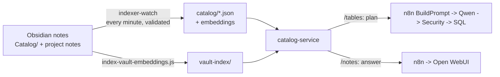

# Architecture

One n8n workflow, two models in Open WebUI: **Text2SQL** (numbers from the warehouse) and **Obsidian notes**
(answers from the notes). The search for both runs in **catalog-service**, not in n8n.



**Where Obsidian is used** - Obsidian is where everything is written; nothing about tables lives in n8n:
- *In:* the catalog notes (`Catalog/`) are the catalog. `indexer-watch` turns them into `catalog/*.json` every
  minute (validated; on a mistake nothing is written) and embeds them. catalog-service reads those files and keeps
  them in memory until they change, so an edit in Obsidian reaches the model within a minute.
- *Out:* every answer ends with the notes it came from (`📎 یادداشت‌های Obsidian: Fact_Sales · ...`);
  `Obsidian note` -> `Save to Obsidian Inbox` write review notes into `Inbox/n8n`.


In n8n the canvas is split into labelled sections 1-6.

## Nodes that matter

Every Code node's source is `n8n_workflows/code/<node name>.js` (synced into the workflow JSON), and every one has
the same shape: settings at the top -> `readN8nInputs()` (the only place that reads other nodes) -> small functions
with one job each -> one `return`. `npm test` checks this (`tests/node-structure.test.js`).

**Find Tables** (n8n HTTP node -> `catalog-service/text2sql/find-tables.js`) - decides *what* goes into the
prompt; writes no prompt text. Its output in n8n *Executions* is the plan plus `logs` (SCORES, DOMAINS, WHY, ...).
1. `resolveAccess` - which catalogs/entities the user's AD groups allow.
2. `scoreEntities` - keyword score (Persian-normalised synonyms, names, columns) + semantic score
   (question vector vs table card and distinctive column vectors, top-3 column mean).
   `matchMetrics` - metric names in the question; their tables count as synonym matches.
   Confidence (`lowConfidence`) is decided here, before the next two bonuses.
   `matchValues` - stored values from `catalog/values.json` found in the question (exact, or a phrase inside values);
   their tables +3/+1. `patternBonus` - `patterns_fa` (Persian year/month -> `Dim_Date`).
3. `selectDomains` - at most 3 domains, each within 60% of the best one.
4. `selectEntities` - top tables + join closure (`from -> to`) over the catalog `joins`
   (`from`, `from_column`, `to`, `to_column`, `type`, `inferred` - the "Links to other tables" of each table note).
   `completeJoinPaths` - connects matched tables that are not joined directly through link tables (log `JOIN PATH`).
   Joins come from this graph, never from embeddings, so two tables are never "connected" by a guess.
   `rankExamples` / `linkExampleTables` - examples from the catalogs and `query_bank.json`, most similar to the question
   first (embedding + shared words); an almost identical one (>= 0.85) brings its tables.
   Output: a plan - tables in order of importance, their joins, hints, examples, values, metrics.

**BuildPrompt** (`BuildPrompt.js`) - only *writes* the prompt from that plan; no catalog access. A plan
`{ refusal: '⛔ ...' }` (e.g. no access) goes to ErrorFormat. Every join between the chosen tables is written
into the prompt as `RELATIONSHIPS` (`[A].[col] = [B].[col]`).
`packPrompt` fits tables top-down into the 24 000-character budget (~8k Qwen tokens) and drops examples/values/metrics
whose tables did not fit; `renderPrompt` is the whole prompt text (rules + today's date in both calendars, hints,
METRICS, VALUES, up to 4 examples, DDL with sample values for small columns). To change the prompt wording, edit
`renderPrompt` only. The model answers UNDERSTOOD -> PLAN -> SQL.

**AuthCheck** - who the user is and what they may do: `groups` (Find Tables matches them to catalog `permissions`)
and `can` = `{ seeDetails, evalMode, reviewNotes, projectNotes }` from the `RIGHTS` table at its top. It is the only node that names
an AD group; to give a group a right, edit `RIGHTS` there.

**Other nodes**: `Notes or data?` (`mode` from Open WebUI), `Ask Notes` (catalog-service answers from the notes),
`Format Answer` (Markdown table + chart + the notes it used; `CHART_BASE_URL` at the top), `ErrorFormat` (technical
details only when `can.seeDetails`), `Retry once?` -> `Build Fix Prompt` (one repair try through the same
`request to LLM`, `Security` and `execute query`), `Audit Row` -> `Write Audit Log`,
`Obsidian note` -> `Save to Obsidian Inbox`. One `Respond to Webhook` for answers and errors.

**Security** (`n8n_workflows/code/Security.js`)
1. Extract SQL from the model reply (ignore Persian prose, keep `[...]`, `"..."`, `'...'`); the PLAN is returned
   as `plan` and shown as thinking, never read as SQL.
2. `NOT_SUPPORTED` -> polite message.
3. Read-only check: blocked keywords, no comma joins, single statement.
4. Force `TOP 200`.
5. Rewrite every table reference, qualified or not, to the user's entity CTE;
   unknown tables are rejected.
6. Prepend the CTEs, which expose only the allowed columns.

## catalog-service
A small Node.js container (`catalog-service/`, no npm packages) - the search over the Obsidian notes for n8n.
Its port is not published: it trusts the AD groups n8n sends, so only the containers of this compose project (n8n)
can reach it - never publish it with `ports:` (a test checks).

| File | One job |
|---|---|
| `server.js` | HTTP only: `POST /tables`, `POST /notes`, `GET /health`; checks the request shape (400 if wrong) |
| `use-cases.js` | `tables()` and `notes()`: puts the parts below together; a ⛔ refusal is an answer, not an error |
| `knowledge.js` | reads `catalog/*.json` and `vault-index/` and keeps them until a file changes |
| `clients.js` | the embeddings service (a failure = keyword search only) and the LLM (`/combine`, same as n8n) |
| `text2sql/find-tables.js` | which tables, joins, examples, values, metrics (moved from n8n unchanged) |
| `notes/find-notes.js` · `notes-prompt.js` · `notes-answer.js` | which notes the user may see -> prompt -> answer + sources |
| `config.js` | settings (`EMBED_URL`, `LLM_URL`, ...), set in `docker-compose.yml` |

**Notes search** (`/notes`): `scripts/index-vault-embeddings.js` (in `indexer-watch`) builds `vault-index/`:
- every **table is one piece**, built from the catalog: description, synonyms, every column the model may see and
  its joins in both directions (`scripts/lib/table-pieces.js`). A table is never cut apart from its columns or links;
- every other note is cut at `##` (`scripts/lib/vault-notes.js`), never inside a ```` ``` ```` block.
`find-notes.js` keeps the pieces the user may see, scores meaning (question vector) + shared words (rarer words
weigh more) and sends the best 8 (≤ 16 000 characters, ≤ 3 per note) to Qwen, which answers only from them.
Setup and use: [[How-to#Obsidian notes model]].

## Catalog contract
Written in the notes (`scripts/lib/catalog-notes.js` defines the note format in both directions); stored as JSON:
`domain`, `description_fa`, `shared`, `hints_fa`, `permissions` (AD group -> `*` or entity list),
`entities[]` (`name`, `kind`, `source`, `core`, `synonyms_fa`, `columns[]` with `exposed` / `review` / `alias`),
`joins[]` (FK `from` -> PK `to`), `examples[]`. Browse it in `Catalog/`.

## Why it works this way
- **Shared dimensions in `common.json`** (rhk_branch_04): the 7 dimensions used by several domains live once
  instead of in every catalog, so a fix is made in one place and the prompt has no duplicates.
  A shared table alone never activates a domain.
- **Domain routing** (rhk_branch_04): 6 catalogs / 152 tables do not fit one prompt, and unrelated tables confuse
  the model. So at most 3 domains (each ≥ 60% of the best) and a character budget (17 000, now 24 000 for Qwen 32B). It was 2 domains, but
  mixed questions lost the sales domain. A missing table is usually a missing synonym - fix the catalog, not the code.
- **Qualified names go through the CTEs** (rhk_branch_05): `[dbo].[Fact_Sales]` used to bypass the CTE, so an
  HR-only user could read sales, and 19 entity names equal older physical tables. Now every reference becomes the
  entity CTE or is rejected; a model CTE named like an entity is rejected too.
- **Join paths on the catalog graph** (rhk_branch_05): the closure only follows `from -> to` one step, so a
  link table (e.g. `Procurement_Fact_Inventory` between invoice state and delivery state) reached the prompt only
  if it matched a word. Now the shortest valid path between matched tables adds it (≤ 2 per path, ≤ 3 per
  question, only readable tables). Never through a dimension both sides only reference (`A -> D <- B`, fan trap).
  The graph comes from `joins` in the catalog - the same data Obsidian draws - not from the Obsidian notes.
- **Examples by similarity, only when their tables are in the prompt** (rhk_branch_05, step 3): fixed examples ignored the
  question (DAIL-SQL). An example whose tables the user cannot read would leak another domain's schema; one whose tables
  are not in the prompt makes the model reference tables Security rejects. Benchmark questions are never copied into
  the bank (a test checks it), so the benchmark still measures generalisation.
- **Values are looked up, not guessed** (step 2): a value written differently from the database returns an empty result
  with no error. Value matches raise table scores but not the confidence: «هوای تهران» must still look unanswerable.
  `values.json` is real data, so it is built on the server and never committed.
- **Metrics are definitions, not hints** (step 5): «فروش خالص» has one correct formula with a mandatory filter; the model
  gets it word for word. A metric counts like a synonym of its tables (a floor, not an extra bonus) - adding it on top
  of the synonym it repeats pushed sales out of a mixed sales + purchase question.
- **Dim_Date is shared** (step 5): every domain asks for Persian years and months; HR/BOM/inventory users get only this
  table from `common.json` (entity-level permission). Its join is a date expression, so it is a scoped hint, not a `joins` entry.
- **Two nodes: Find Tables + BuildPrompt** (rhk_branch_05): one 1 000-line node did both the search and the prompt
  text. Split so each has one job, the prompt wording can be changed without touching the search, and n8n's
  Executions show the plan (chosen tables) separately from the prompt. Only the small plan passes between them, never
  embedding vectors. Verified: identical prompts before and after on 160 question/vector combinations.
- **PLAN before SQL** (step 6, DIN-SQL / CHASE-SQL): three short lines; Security accepts only a line-start `SQL:` label
  so plan text with "with"/"select" in it is never executed.
- **Meaning score relative to the question** (rhk_branch_05): the raw similarity of every embedding model has a
  baseline (bge-m3 gives ~0.4 even to unrelated text), so "similarity × 4" gave every table ~1.6 points: past the
  selection threshold, and the "probably not answerable" warning almost never fired; the numbers had to be re-tuned for
  each model. Now a table gets meaning points only when it stands out: more than 2 standard deviations above the mean
  similarity of all catalog tables to this question (all tables, not only the user's: with 4 numbers nothing can stand out;
  the others' vectors only enter the mean). Ordering by meaning is unchanged; nothing needs tuning.
- **Reasons, not numbers** (rhk_branch_05): each chosen table carries plain reasons (`retrieval.why`, `WHY` log, the
  Obsidian note) - «مترادف «فروش»», «معنای نزدیک به سوال», a metric, a value, a link table. Scores only order tables.
- **Review by ticking, not by writing SQL** (rhk_branch_05): writing gold SQL was the bottleneck for measuring accuracy.
  A reviewer ticks ✅/❌ on an answered-question note; ✅ stores the model's SQL as a verified bank example and the exact
  query that ran as a *confirmed* benchmark question (a regression check, kept out of the accuracy %, since it was
  chosen because the model already got it right). The answer was checked by a person who knows the data; that is the gold.
- **The system checks itself** (rhk_branch_05): `indexer-watch` runs the offline retrieval benchmark after each change
  (with embeddings when the service answers) and writes the result in words to `Inbox/System check.md`. Its floor is
  also a test: a refactor once silently dropped one question (36 -> 35); `npm test` now fails on any drop.
- **Obsidian is the catalog, JSON is generated** (rhk_branch_05): editing in Obsidian should change what the model
  knows. n8n does not parse the notes itself: a typo would then break every question, Markdown parsing would run on
  every question, and the embeddings would not follow. Instead a script in `indexer-watch` converts and validates
  them once a minute and writes only a valid catalog; the System check note names the note with a mistake. The format
  is lossless (notes -> JSON -> notes gives the same bytes, tested on all 7 catalogs). One-time change at the switch:
  joins are stored grouped by table (they now live in the table notes); the same tables and prompt lines in 310 of
  312 cases, the other two swap an equally scored dimension at the 24 000-character limit. Not in notes on purpose:
  the answer format and the security rules (the Security node parses that format; a note edit must never open the DB).
- **SOLID in n8n Code nodes** (rhk_branch_05): one job per node, one adapter that reads n8n, rights decided once in
  AuthCheck (they were copied in three nodes; a fourth copy would have drifted). Verified: old and new code give
  identical output on 3 546 input combinations. Find Tables stays one node with 8 step functions: splitting it into
  n8n nodes would pass the catalogs and embedding vectors between nodes, and n8n stores every node's output for every
  question.
- **What is embedded** (rhk_branch_05): one card per table + one vector per *distinctive* column (keys and
  descriptions repeated in 3+ tables get none); a table's column score is the mean of its top 3 columns.
  Fewer, cleaner vectors: 1 470 -> 571, sidecars 13 MB -> 4.8 MB.
- **Notes answers use retrieval, not the whole vault** (obsidian_01): the vault is ~250 000 characters
  (~85 000 tokens), five times Qwen's 16 384-token context. So the notes are embedded once (after a change) and
  each question gets the ~8 closest pieces. Qwen is not "connected" to Obsidian: it only sees what the prompt holds.
- **Same access for notes as for SQL** (obsidian_01): the index carries the catalog `permissions`, so a `NLSQL-hr`
  user learns nothing about sales tables from the notes either. A domain note needs `*` on the domain (its rules
  and example SQL name other tables). Project notes are for `IT - Data` / `IT - Security` (`can.projectNotes`).
  Never indexed: `Inbox/` (real questions), `CLAUDE.md`, `hidden` columns. A shared table's piece lists only joins
  to its own or shared tables (Dim_Date is joined from every domain; listing them would name sales tables to HR).
- **The search left n8n** (obsidian_02): n8n read every catalog file (~5 MB) and ran a 1 000-line Code node on every
  question, in 5 nodes (ReadCatalog, ParseCatalog, Embed Question, Merge, Find Tables). Now catalog-service keeps the
  catalog in memory and n8n makes one HTTP call. Verified: the prompt of every benchmark question (468 question /
  group / embedding combinations) is byte-for-byte the same before and after the move.
- **One workflow, two models** (obsidian_02): the notes questions had their own 12-node workflow repeating LDAP,
  AuthCheck, the embeddings and the LLM call. Now Open WebUI's model choice sends `mode`, one IF node routes it and
  catalog-service answers notes questions in one call. Chosen by the user, not guessed: «فروش خالص چطور حساب
  می‌شود؟» names a metric, so a router would send it to SQL although it asks for a definition. 33 -> 19 nodes.
- **Whole tables, not text chunks** (obsidian_02): cutting table notes at headings put a table's columns in two
  pieces and its links in a third, so a question could get half a table or lose a join. For SQL the search unit was
  always the table (whole table into the prompt, joins from the graph); now the notes search does the same.
- **One node per job** (obsidian_01): `Retry: request to LLM` and `Retry: execute query` were copies of
  `request to LLM` / `execute query`, and there were two identical `Respond to Webhook` nodes. A copy is a place to
  forget a fix (it happened once: `Retry: Security`), so the retry now goes through the same nodes;
  `Retry once?` on the query's error output decides between the repair try and the error. The old
  AdventureWorks runner `Text-to-SQL Benchmark-01.json` (a copy of Benchmark-02 calling a webhook that no longer
  exists, with an hourly trigger) was removed; it is still on `rhk_branch_05`.
- **[[Schema]] is generated** (obsidian_01): one page with all tables by domain, for people and for the notes model
  («چه جدول‌هایی در حوزه خرید داریم؟»). Written from `catalog/*.json` by `scripts/build-schema-note.js` in
  `indexer-watch`, so it can never disagree with the table notes; a test fails when the committed copy is stale.
  No separate index note: [[Home]] is the vault's index.
